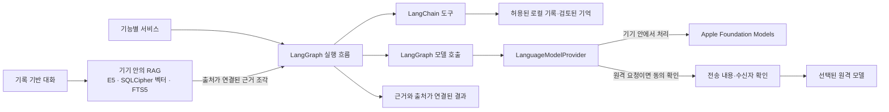

# 오롯: 기록을 모아, 다음 진료를 준비합니다

    

오롯은 상담 녹음, 건강 기록, 진료 일정을 아이폰에 모아 다음 진료를 준비하도록 돕는 개인 건강 기록 앱입니다. 기록의 출처와 시점을 확인하고 AI가 참고한 근거를 살펴볼 수 있습니다.

## 주요 기능

### 상담 녹음과 전사

참여자에게 안내하고 동의를 받은 뒤 상담을 녹음합니다. 전사는 사용자가 따로 요청하면 기기에서 처리합니다.

### 건강 기록과 진료 일정

HealthKit에서 필요한 건강 관찰을 선택해 가져옵니다. 진료 일정은 직접 등록하거나 캘린더 후보를 확인한 뒤 저장할 수 있습니다.

### AI로 진료 준비

다음 진료 질문과 증상 정리, 기록 기반 대화를 이용하고 외부 의학 자료를 검색할 수 있습니다.

### 근거와 질문 확인

AI 응답에서 참고한 기록과 출처를 확인하고, 정리한 질문을 진료 일정에 연결합니다.

## AI 아키텍처

기능별 서비스가 요청 범위와 현재 근거를 정하고, 공유 실행 구성요소가 허용된 도구와 선택된 모델을 연결합니다. 기록 기반 대화에서만 호출자가 준비한 기록 조각을 로컬 RAG로 검색하며, 모든 기록을 자동으로 모델에 전달하거나 색인하지 않습니다.

- **LangChain**은 허용된 로컬 기록과 검토된 기억을 읽는 도구를 제공합니다.
- **LangGraph**는 응답과 근거 조회 단계를 구성하고, 실행 예산·도구 범위·출처를 관리합니다.
- **RAG**는 기기 안에서 E5 임베딩, SQLCipher 벡터 저장, FTS5 키워드 검색을 사용합니다. 호출자가 전달한 출처 연결 조각만 검색하고 모든 기록을 자동 색인하지 않습니다.
- **React Native**는 TypeScript 기반 iOS 앱 화면과 동작을 구성합니다.
- **SQLCipher**는 앱의 로컬 데이터베이스를 암호화합니다.

## 기록과 동의

기록은 기기에 SQLCipher로 암호화해 저장하며 건강 기록을 보관하는 오롯 서버는 없습니다. 외부 모델 요청은 전송 내용과 수신자를 확인한 뒤 별도로 동의해야 합니다. 외부 문헌 검색도 검색어 전송에 대한 동의가 필요합니다. AI 응답은 의료진의 진단을 대신하지 않습니다.

## 문서

- [상세 아키텍처와 데이터 흐름](docs/architecture.md)
- [개발 환경과 검사 방법](docs/development.md)
- [코드 품질 검사](docs/code-quality.md)
