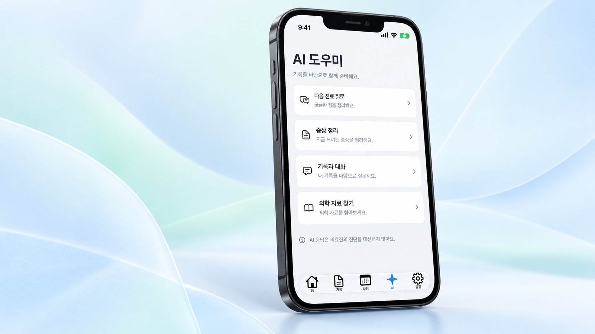
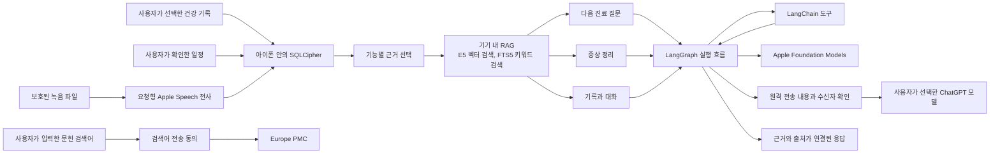

# 오롯: 기록을 모아, 다음 진료를 준비합니다

    

오롯은 상담 녹음, 건강 기록, 진료 일정을 아이폰에 모아 다음 진료를 준비하도록 돕는 개인 건강 기록 앱입니다. AI가 기록을 바탕으로 질문과 설명을 정리하고, 답변에 참고한 근거와 출처를 확인할 수 있습니다.

## 주요 기능

### 상담 녹음과 전사

참여자 안내와 동의, 마이크 권한을 확인한 뒤 상담을 녹음합니다. 음성은 보호된 파일로 저장하며, 사용자가 별도로 요청하면 Apple Speech가 기기 안에서 전사합니다.

### 건강 기록 가져오기

HealthKit에서 필요한 건강 관찰을 선택해 가져옵니다. 가져온 기록에는 출처와 시점이 연결되어 이후 진료 준비에서 원문을 확인할 수 있습니다.

텍스트 PDF와 UTF-8 텍스트 문서도 기기 안에서 읽어 원본을 보호해 보관합니다. 저장 전에 가져온 내용과 페이지·위치 정보를 확인하며, 진단이나 약 변경을 자동으로 확정하지 않습니다. 스캔 이미지 PDF는 OCR을 지원하지 않아 가져올 수 없습니다.

### 진료 일정 관리

EventKit 일정은 후보로 확인하고, 사용자가 선택해 확인한 일정만 저장합니다. 일정은 직접 등록할 수도 있으며, 진료 질문을 저장할 때 연결할 수 있습니다.

### 증상 일지

기록 화면에서 증상의 시작 시각과 상태, 자유로운 설명을 직접 입력하고 필요하면 강도를 선택합니다. 내용을 수정하거나 증상이 해소되었다고 표시해도 처음 기록한 시각은 유지됩니다. 시작 시각과 상태로 조회할 수 있으며, 직접 입력한 기록임을 표시하고 진단을 추정하지 않습니다.

### 다음 진료 질문

현재 일정과 기록에서 관련 근거를 찾아 질문 후보를 만듭니다. 근거 원문을 확인하고 필요한 질문을 검토한 뒤 일정에 저장할 수 있습니다.

### 증상 정리

복약·활동·건강 측정·수면 등 기록의 사실을 요약하거나, 기록을 바탕으로 가능성을 살펴볼 수 있습니다. 두 작업은 각각 선택해 실행하며, 참고한 근거와 남은 불확실성을 함께 확인할 수 있습니다. 진료 때 의료진과 논의하기 위한 자료이며 진단이나 치료 결정을 대신하지 않습니다.

다음 진료 질문, 증상과 기록 요약, 기록과 대화에서는 AI가 기간별 건강 기록을 조회할 수 있습니다. 기본 최근 30일을 기준으로 필요에 따라 7일이나 90일의 복약 기록, 건강 측정의 일별 통계와 변화, 활동과 수면의 기록 범위를 참고합니다. 기록이 없는 날을 미복용이나 활동 없음으로 추정하지 않습니다. 서로 겹칠 수 있는 기기별 걸음 수를 합산하지 않으며, 수면 시간은 날짜별로 겹치는 구간을 합쳐 계산합니다.

검증을 통과한 기록 요약은 기기에 저장합니다. 오른쪽 위 히스토리 버튼으로 별도의 저장된 요약 화면을 열고, 앱을 다시 연 뒤에도 이전 요약과 연결된 원문을 확인할 수 있습니다. 원본이 바뀐 경우에는 생성 당시의 요약임을 표시합니다.

### 기록과 대화

질문에 맞는 기록을 검색해 답변하고, 참고한 기록의 출처로 이동할 수 있습니다. 전체 기록을 자동으로 검색하거나 모델에 보내지 않고, 각 기능이 준비한 근거만 사용합니다.

화면을 오가도 대화 내용과 진행 중인 요청을 유지합니다. 별도의 대화 기록 화면에서 대화를 선택하거나 오른쪽에서 왼쪽으로 밀어 삭제할 수 있으며, 삭제 직후에는 실행 취소할 수 있습니다.

### 의학 자료 찾기

Europe PMC에서 의학 문헌을 검색하고 원문 링크와 출처 정보를 확인할 수 있습니다. 직접 입력하거나 AI가 구성한 검색어를 Europe PMC로 보내기 전 별도 동의를 확인합니다. 개인 기록 원문을 검색 요청에 일괄 첨부하지 않습니다.

## 기술 스택과 역할

| 기술 | 오롯에서 맡는 역할 |
| --- | --- |
| React Native 0.87.1과 TypeScript 6.0.3 | iOS 앱 화면과 기능별 서비스 구현 |
| LangChain Core 1.2.14 | 기능에서 허용한 기록, 검토된 기억, 외부 문헌을 다루는 도구 구성 |
| LangGraph 1.4.18 | 모델 응답과 근거 조회 흐름을 구성하고 실행 예산과 인용을 검증 |
| @orot/rag와 E5, FTS5 | 기기 안에서 벡터 검색과 키워드 검색을 결합해 출처가 연결된 기록을 찾음 |
| SQLCipher | 로컬 기록과 검색 벡터를 암호화해 저장 |
| iOS HealthKit, EventKit, Apple Speech | 건강 기록 선택, 일정 확인, 요청형 기기 내 전사 |
| Apple Foundation Models와 ChatGPT | 기기 내 모델 또는 사용자가 선택한 원격 모델 제공 |

## AI 구조

각 기능은 현재 사용할 수 있는 근거를 준비한 뒤 필요한 AI 실행 흐름에 전달합니다. 로컬 RAG는 다음 진료 질문, 증상 정리, 기록과 대화에서 공통으로 쓰입니다. LangChain 도구는 기능이 허용한 기록과 검토된 기억을 읽고, LangGraph는 응답과 근거 조회 단계를 연결해 인용과 실행 범위를 확인합니다.

RAG는 호출자가 준비한 출처 연결 근거만 검색합니다. E5 임베딩 순위와 FTS5의 BM25 키워드 순위를 결합하며, 전체 데이터베이스를 자동으로 색인하지 않습니다. 원격 모델 요청에는 수신자와 정보 종류·허용 범위를 확인하는 별도 동의가 필요합니다. 같은 계정과 AI에서 같은 기능으로 같은 종류와 범위의 정보를 전송할 때는 한 번 받은 동의를 재사용하며, 일정 분류 묶음이나 기록 값이 달라져도 다시 묻지 않습니다. 동의 범위의 SHA-256 해시만 암호화된 저장소에 보관하고, 설정에서 동의 내역을 지울 수 있습니다. 의학 문헌 검색은 별도의 검색어 전송 동의를 같은 방식으로 기억합니다.

## 기록과 동의

건강 기록은 아이폰 안의 SQLCipher 데이터베이스에 저장하며 오롯 자체 서버는 건강 기록을 보관하지 않습니다. 녹음 파일은 데이터베이스와 분리된 보호 파일로 저장합니다. AI 응답은 의료진의 진단을 대신하지 않습니다.

## 문서

- [상세 아키텍처와 데이터 흐름](docs/architecture.md)
- [개발 환경과 검사 방법](docs/development.md)
- [코드 품질 검사](docs/code-quality.md)
