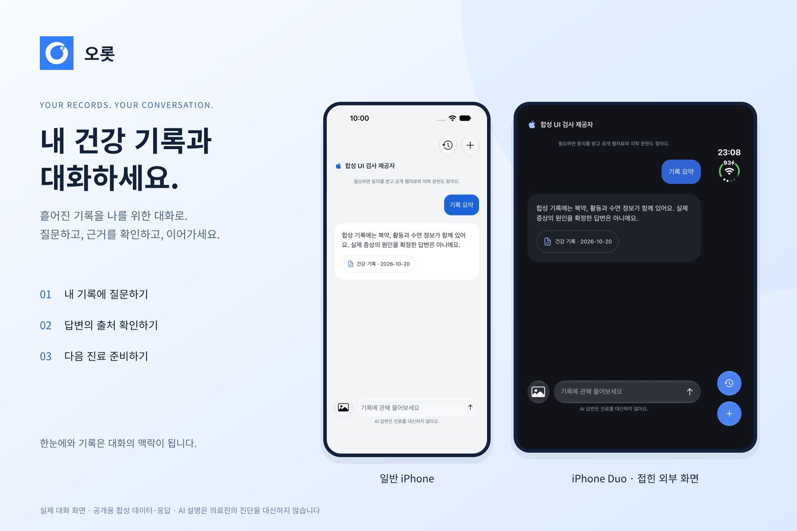
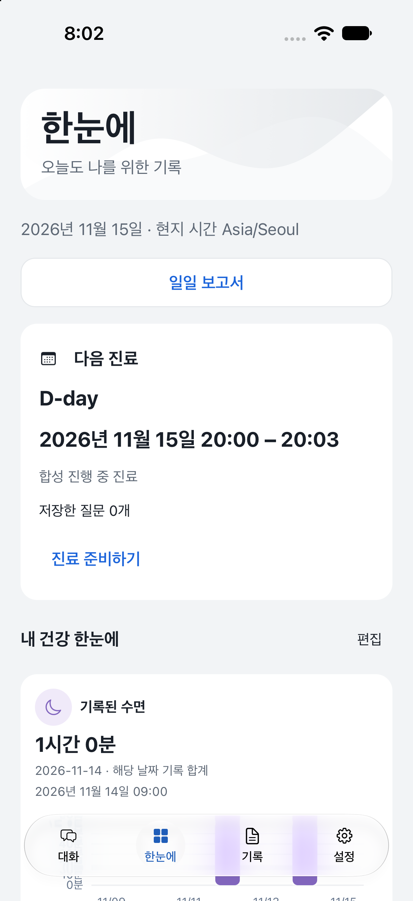
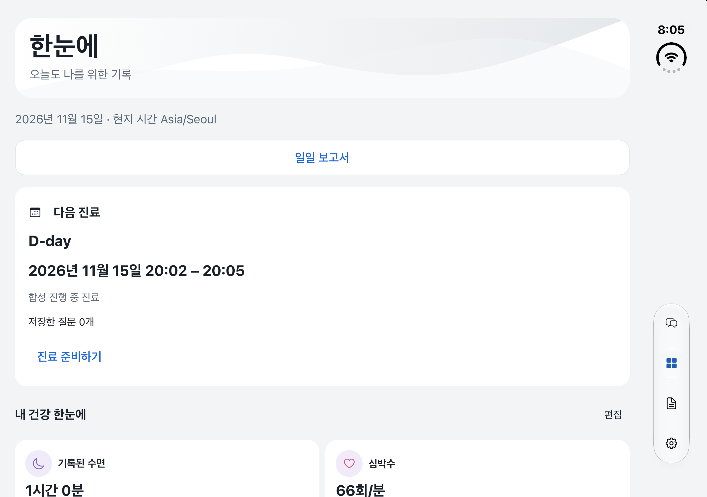
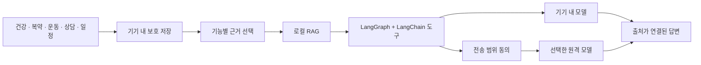

# 오롯

### 흩어진 건강 기록을, 나를 위한 대화로.

기록을 모으고 · 근거를 확인하고 · 다음 진료를 준비합니다.

[기능](#기록에서-대화까지) · [화면](#한-손에서도-펼친-화면에서도) · [구조](#아이폰-안에서-시작하는-ai) · [개발 시작](#함께-만들기)

> 건강 기록을 이해하고 진료를 준비하는 앱입니다. AI의 설명은 진단이나 치료 결정을 대신하지 않습니다.

## 기록에서 대화까지

| 하고 싶은 일             | 오롯에서                                                                       |
| ------------------------ | ------------------------------------------------------------------------------ |
| **내 기록에 물어보기**   | 필요한 기록을 찾아 답변하고, 확인한 자료와 원문 출처를 연결합니다.             |
| **오늘의 건강 돌아보기** | 복약·운동·수면·측정·증상·일정 맥락으로 일일 보고서를 만들고 대화를 이어갑니다. |
| **다음 진료 준비하기**   | 일정과 관련 기록을 바탕으로 질문 후보를 만들고, 검토한 질문을 저장합니다.      |
| **상담 내용 남기기**     | 참여자 동의 후 녹음하고, 요청하면 기기 내 전사로 기록을 정리합니다.            |
| **건강 기록 모으기**     | HealthKit 관찰·운동 기록, 텍스트 PDF·문서, 직접 남긴 기록을 모읍니다.          |
| **근거 살펴보기**        | 기록 요약과 가능성 검토를 구분하고, 출처와 남은 불확실성을 확인합니다.         |
| **말로 대화하기**        | Apple 시스템 음성 또는 별도 동의한 OpenAI Realtime 음성 대화를 선택합니다.     |

[기능별 상세 동작과 제한 보기](docs/features.md)

## 한 손에서도, 펼친 화면에서도

| 일반 iPhone                                                                      | iPhone Duo                                                                   |
| -------------------------------------------------------------------------------- | ---------------------------------------------------------------------------- |
| 진료 일정과 건강 기록을 한 화면씩 집중해서 봅니다.                               | 펼친 화면에서 건강 기록을 넓은 카드로 확인합니다.                            |
|  |  |

## 대화 중에도, 다음에 돌아와도

- **추가 지시**: 진행 중인 답변에 방향을 더하고, 다음 안전한 실행 단계에 반영합니다.
- **Stop**: 중단 요청과 처리 상태를 구분하고 기존 내용을 보존합니다.
- **대화 기록**: 이전 대화·저장된 요약·진료 질문을 다시 열고 원문을 확인합니다.
- **체크포인트 재개**: 지원되는 중단 지점은 LangGraph 상태에서 이어갑니다. 결과가 불명확한 외부 호출을 무조건 다시 실행하지 않습니다.

## 내 기록과 전송 범위를 분명하게

| 경계          | 처리 방식                                                                                                        |
| ------------- | ---------------------------------------------------------------------------------------------------------------- |
| **기록 저장** | 아이폰의 SQLCipher 데이터베이스에 암호화합니다. 녹음은 별도 보호 파일로 보관합니다.                              |
| **자체 서버** | 오롯 자체 서버에 건강 기록을 보관하지 않습니다.                                                                  |
| **로컬 검색** | 기능이 준비한 출처 연결 근거를 검색합니다. 전체 데이터베이스를 무조건 색인하거나 전송하지 않습니다.              |
| **원격 AI**   | 수신자·정보 종류·범위를 확인한 동의가 필요합니다. 동의 내역은 설정에서 지울 수 있습니다.                         |
| **의학 문헌** | Europe PMC 검색어 전송은 별도 동의 대상이며, 개인 기록 원문을 일괄 첨부하지 않습니다.                            |
| **음성 통화** | Realtime은 현재 통화 음성을 OpenAI로 전송하며 API 요금이 발생할 수 있습니다. 기존 자료는 자동 전송하지 않습니다. |

지원 범위와 알아둘 점

- 현재 제품 언어는 한국어입니다. 문구를 번역 체계로 옮기는 작업이 다른 언어 제공을 뜻하지는 않습니다.
- 일일 보고서는 직접 생성을 요청합니다. 알림을 열거나 작업을 선택하는 것만으로 생성·전송하지 않습니다.
- 기록이 없다는 이유로 미복용·활동 없음으로 판단하지 않습니다. 서로 겹칠 수 있는 기기별 수치를 무조건 합산하지 않습니다.
- 일정은 계획입니다. 참석·복용·진단의 증거로 자동 확정하지 않습니다.
- 스캔 PDF의 OCR은 지원하지 않습니다. 텍스트 PDF와 UTF-8 문서를 가져올 수 있습니다.
- Realtime 통화 전사는 임시 표시이며, 검증된 의료기록으로 자동 저장하지 않습니다. 실제 음향·통화 품질 검증은 별도입니다.
- 실제 모델의 의료적 해석 품질과 실제 기기에서의 모든 중단·발열 사례가 검증된 것은 아닙니다.
- 일부 모델·음성·플랫폼 기능은 기기, OS, 계정과 권한에 따라 사용할 수 없습니다.

## 아이폰 안에서 시작하는 AI

| 레이어   | 기술                                | 역할                                             |
| -------- | ----------------------------------- | ------------------------------------------------ |
| 앱       | React Native · TypeScript           | iOS 화면과 기기별 적응형 레이아웃                |
| 에이전트 | LangGraph · LangChain Core          | 모델·도구 실행, 인용, 체크포인트와 지원되는 재개 |
| 검색     | E5 · FTS5                           | 기기 내 벡터·키워드 검색 결합                    |
| 보관     | SQLCipher · 보호 파일               | 기록·검색 벡터와 녹음 보관                       |
| iOS 연동 | HealthKit · EventKit · Apple Speech | 건강 기록, 일정, 요청형 전사                     |
| 모델     | Apple Foundation Models · ChatGPT   | 기기 내 또는 사용자가 선택한 원격 모델           |

[상세 아키텍처와 데이터 흐름](docs/architecture.md)

## 함께 만들기

| 찾는 정보             | 문서                                                                                                      |
| --------------------- | --------------------------------------------------------------------------------------------------------- |
| 설치하고 실행하기     | [개발 환경](docs/development.md)                                                                          |
| 화면과 상호작용 원칙  | [디자인 시스템](DESIGN.md)                                                                                |
| 어떤 검사를 실행할까? | [테스트 정책](TEST.md) · [코드 품질](docs/code-quality.md)                                                |
| iOS 검증 범위         | [검증 기록](docs/ios-validation.md)                                                                       |
| 배포 절차             | [릴리즈 안내](docs/releasing.md)                                                                          |
| 다음 작업과 제안      | [이슈](https://github.com/eunsoogi/orot/issues) · [Pull requests](https://github.com/eunsoogi/orot/pulls) |
